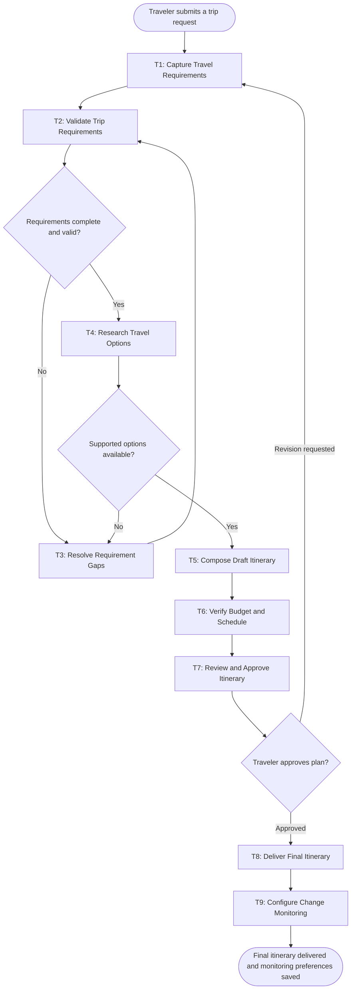

# Workflow of Tasks

## 1. Workflow Goal

This workflow supports the goal in our completed [team charter](https://github.com/clairerobinson2023-coder/BUS4498_Team_Build/blob/main/README.md): reduce the time and effort needed to plan a personalized trip while keeping the itinerary realistic and within the traveler’s stated budget and preferences.

## 2. Workflow Trigger

A traveler starts a run by submitting a request for a trip, including at least the destination, travel dates, number of travelers, budget, transportation needs, lodging preferences, interests, and scheduling constraints.

## 3. Completion Condition at Runtime

One run is complete when the traveler has approved a final itinerary, received the itinerary and budget summary, and the system has saved the traveler’s approved change-monitoring preferences for the trip.

## 4. General Workflow

The traveler first provides trip requirements. The system checks that the minimum planning information is present. If information is missing or unclear, the traveler resolves those gaps before the system researches available transportation, lodging, activity, and restaurant options. The agent compares options and returns a supported set of recommendations. The system then composes a draft itinerary and checks its total estimated cost, timing, and scheduling conflicts. The traveler reviews the plan and either approves it or asks to revise the requirements. An approved plan is delivered as a final itinerary and budget summary, and the system saves the traveler’s change-monitoring preferences.

If a permitted source is unavailable, returned options are incomplete, or the agent cannot support a recommendation with enough information, the workflow records the limitation and sends the case to the traveler for a decision. It does not make reservations, purchases, account changes, or send messages to outside providers. If the traveler asks for revisions, the workflow returns to requirement capture and creates an updated plan. While the traveler is reviewing or resolving a gap, the run is paused.

## 5. Workflow Diagram

